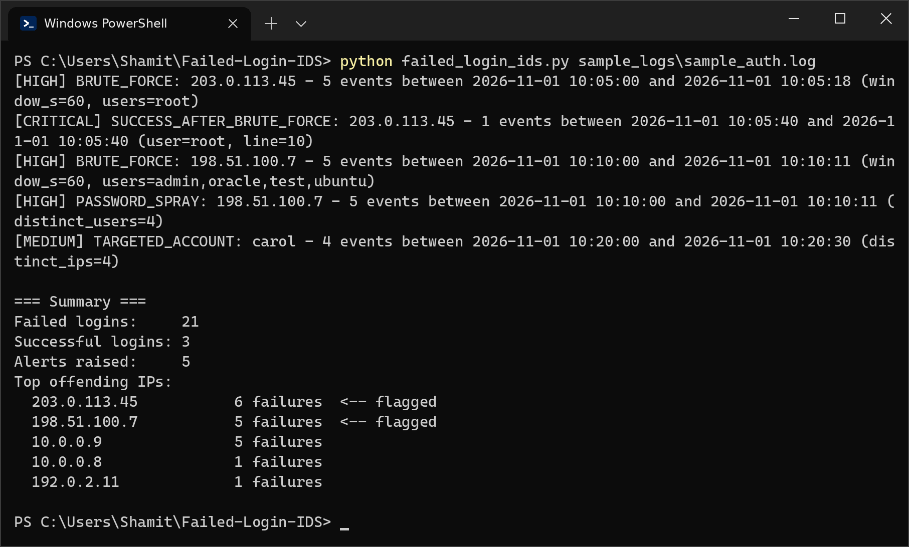

# Failed Login Intrusion Detection System

A lightweight, host-based **intrusion detection system (IDS)** written in Python that scans authentication logs for **repeated failed login attempts** and raises alerts for brute-force attacks, password spraying, targeted account attacks and — most importantly — **a successful login right after an attack**.

No external libraries. One file. Runs on Windows, Linux and macOS with Python 3.7+.



---

## Features

| Detection | What it means | Severity |
|---|---|---|
| **Brute force** | One IP fails ≥ *N* times within *T* seconds | HIGH |
| **Password spraying** | One IP tries many different usernames | HIGH |
| **Targeted account** | One username attacked from many different IPs | MEDIUM |
| **Success after brute force** | A flagged IP then logs in successfully — possible compromise | CRITICAL |

- **Sliding time window**: occasional typos don't trigger alerts, only bursts do
- Reads **SSH (`sshd`)**, **PAM** and simple **application** log formats
- **Live monitoring** mode (`--follow`, like `tail -f`)
- **JSON output** for SIEMs, dashboards or further scripting
- **IP whitelist** for trusted hosts
- Exit code `1` when alerts are found, `0` otherwise, so it's easy to use from cron jobs and scripts

## Quick start

**Windows (PowerShell / Command Prompt)**

```powershell
git clone https://github.com/shamit64/Failed-Login-Intrusion-Detection-System.git
cd Failed-Login-Intrusion-Detection-System
python failed_login_ids.py sample_logs\sample_auth.log
```

**Linux / macOS**

```bash
git clone https://github.com/shamit64/Failed-Login-Intrusion-Detection-System.git
cd Failed-Login-Intrusion-Detection-System
python3 failed_login_ids.py sample_logs/sample_auth.log
```

You can analyse log files copied from any Linux server, or exported from your own applications, on a Windows machine.

## Usage

```bash
# Scan the system auth log (Ubuntu/Debian; use /var/log/secure on RHEL/CentOS)
sudo python3 failed_login_ids.py /var/log/auth.log

# Stricter rule: alert on 10 failures within 5 minutes
python3 failed_login_ids.py auth.log --threshold 10 --window 300

# Machine-readable output
python3 failed_login_ids.py auth.log --json > alerts.json

# Watch a live log
sudo python3 failed_login_ids.py /var/log/auth.log --follow

# Ignore trusted IPs
python3 failed_login_ids.py auth.log --whitelist 10.0.0.5 10.0.0.6
```

| Option | Default | Description |
|---|---|---|
| `-t, --threshold` | 5 | Failures from one IP within the window that trigger a brute-force alert |
| `-w, --window` | 60 | Sliding window size in seconds |
| `--spray-users` | 4 | Distinct usernames from one IP that count as password spraying |
| `--target-ips` | 4 | Distinct IPs failing on one username that count as a targeted attack |
| `--whitelist` | – | IPs to ignore |
| `--year` | current year | Year to assume for syslog timestamps (they don't include one) |
| `--json` | off | Print alerts as JSON |
| `-f, --follow` | off | Keep watching the file for new lines |

## How it works

1. **Parse**: each log line is matched against regular expressions for failed and successful logins, extracting the timestamp, source IP and username.
2. **Track**: failures are stored in a per-IP queue and a per-username queue (`collections.deque`). Entries older than the window are dropped from the front, so each queue holds only recent activity.
3. **Detect**: after every event, the detection rules are checked against the current window.
4. **Alert**: each alert type is raised once per IP or username, so one attack doesn't flood the output. A summary of the top offending IPs is printed at the end.

```
log line ──► parse ──► Event(ts, ip, user, success)
                             │
              ┌──────────────┴──────────────┐
              ▼                             ▼
      per-IP window (deque)        per-user window (deque)
      • brute force                • targeted account
      • password spraying
      • success after attack
              └──────────────┬──────────────┘
                             ▼
                          ALERTS
```

## Supported log formats

```
Nov  1 10:05:00 host sshd[1010]: Failed password for root from 203.0.113.45 port 40001 ssh2
Nov  1 10:10:02 host sshd[1021]: Failed password for invalid user admin from 198.51.100.7 port 41000 ssh2
Nov  1 10:10:00 host sshd[1020]: Invalid user admin from 198.51.100.7 port 41000
Nov  1 10:12:00 host sshd[1025]: pam_unix(sshd:auth): authentication failure; ... rhost=198.51.100.7  user=root
Nov  1 10:05:40 host sshd[1016]: Accepted password for root from 203.0.113.45 port 40007 ssh2
2026-11-01T10:05:00 app: LOGIN FAILED user=alice ip=192.0.2.5
```

## Running the tests

```bash
python3 -m unittest discover tests -v
```

## Project structure

```
Failed-Login-Intrusion-Detection-System/
├── failed_login_ids.py       # the detector
├── sample_logs/
│   └── sample_auth.log       # sample log with 4 simulated attacks
├── tests/
│   └── test_detector.py      # unit + end-to-end tests
├── docs/
│   └── demo_output.png
├── README.md
└── LICENSE
```

## Future enhancements

- Automatically block offending IPs (iptables / ufw / firewalld)
- E-mail, Slack or Telegram notifications
- GeoIP lookup of attacking IPs
- Web dashboard showing attack trends

## Author

**Thummuru Shamit Sai Ganesh Reddy** · [GitHub @shamit64](https://github.com/shamit64)

## License

MIT, see [LICENSE](LICENSE).
